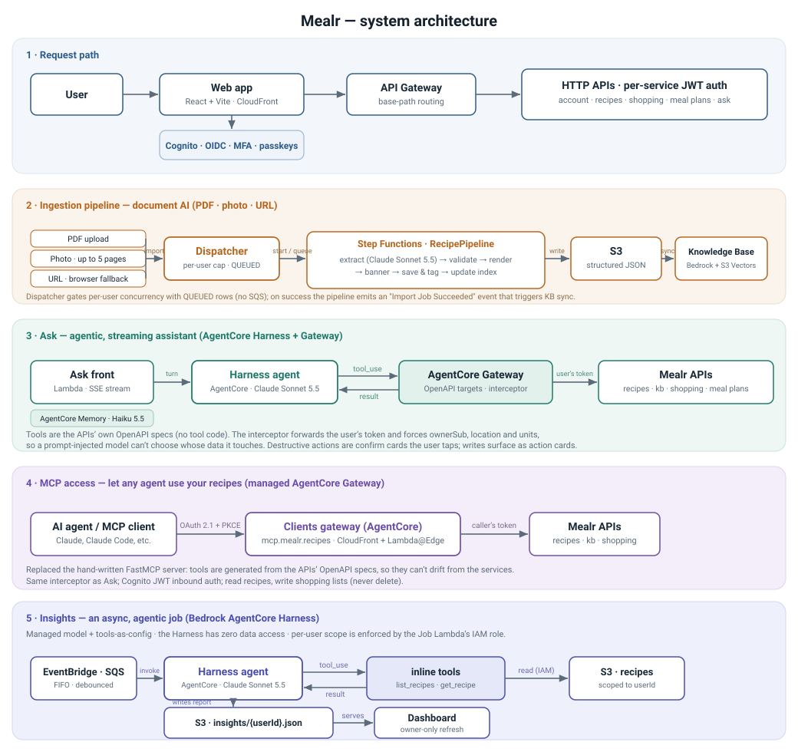
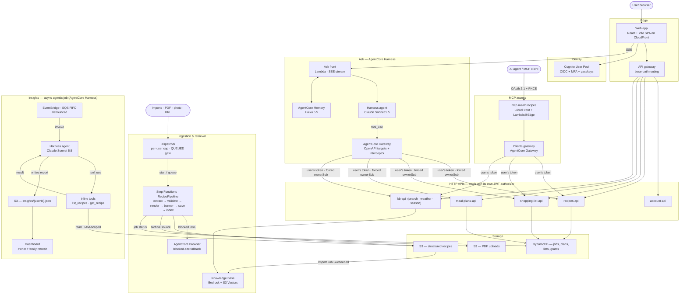

# Mealr — an agentic AI recipe platform

> **Case study / architecture showcase.** This repository documents the design of Mealr, a production serverless platform with conversational AI over a user's own recipes. The application source is private; this repo exists to walk through the architecture and the agentic-AI engineering behind it.

Built and architected by **Derrick Bryant** — [LinkedIn](https://www.linkedin.com/in/derrick-bryant) · [GitHub](https://github.com/dbryant4)

---

## Contents

- [What it is](#what-it-is)
- [The agentic AI, in depth](#the-agentic-ai-in-depth)
  - [Ask on Bedrock AgentCore](#ask--an-agentic-assistant-on-bedrock-agentcore-ask-service)
  - [Vector knowledge base](#vector-knowledge-base-kb-service)
  - [Document-AI ingestion pipeline](#document-ai-ingestion-pipeline-pdf-ingestor-service)
  - [MCP access for agents](#mcp-access--let-any-agent-use-your-recipes-mcp-gateway-service)
  - [Meal planning](#meal-planning-meal-plans-service)
  - [AI insights (AgentCore Harness agent)](#ai-insights--a-managed-agentcore-harness-agent-iam-scoped-insights-service)
- [Running it in production](#running-it-in-production)
- [System architecture](#system-architecture)
- [Tech stack](#tech-stack)
- [Engineering practices on display](#engineering-practices-on-display)
- [My role](#my-role)

---

## What it is

Mealr turns a pile of scanned recipe PDFs into a private, searchable, **conversational** cookbook. Upload a photo or PDF of a recipe and an ingestion pipeline extracts it into structured data; ask in plain English ("plan dinners for next week around the chicken I have", "what did I cook last week?") and an agent answers and acts using **only your own recipes** — with citations, and with every change shown as a card you can see and undo.

It's a full multi-service platform — auth, APIs, a React web app, a static marketing site, an event-driven ingestion pipeline, a Bedrock-backed knowledge base, meal planning, and three agent surfaces on **Amazon Bedrock AgentCore** (the Ask assistant, an MCP gateway for external agents, and an insights agent) — deployed entirely as serverless infrastructure-as-code.

---

## The agentic AI, in depth

This is the part that matters for an engineering audience. Mealr isn't a chatbot bolted onto a CRUD app — retrieval, grounding, and per-user isolation are designed in.

### Ask — an agentic assistant on Bedrock AgentCore (`ask` service)
- **Managed agent loop, thin front.** Ask runs on a **Bedrock AgentCore Harness** (Claude Sonnet 5.5, adaptive thinking): model, system prompt and tools are *configuration*. A small streaming Lambda in front handles auth, request context and SSE — it streams the answer token-by-token, shows a "How I got this" trail of tool steps, and sends keepalives so CloudFront never cuts a long turn. The harness is bounded (15 iterations / 240 s), and the prompt is written to plan within that budget.
- **Tools are the APIs, not tool code.** The harness reaches Mealr through an **AgentCore Gateway** whose tools are generated from each service's own **OpenAPI spec** (recipes, knowledge base, shopping lists, meal plans). Nothing is hand-written or duplicated, so tools can't drift from the APIs — a generator with a `--check` mode catches spec drift.
- **Identity can't be prompt-injected.** Every tool call runs *as the end user*: a **REQUEST interceptor** forwards the user's Cognito token (Cognito has no token exchange, so the managed outbound-auth options didn't fit), **forces** `ownerSub` from the server-validated shared-library context, and deletes any value the model supplied. The same pattern forces weather location and °F/°C onto the weather tool, so the model never sees or chooses coordinates. Ratings, notes and cooking history are always the caller's own.
- **What it can do:** semantic search over the user's knowledge base, filter by rating and cooking history, record a cook when the user says they made something, check local weather and what's in season, import a recipe from a link the user typed, build and edit shopping lists, and **plan meals** — propose a week in chat, write it in one call only after the user agrees, then generate the matching shopping list. It plans around what the user has on hand and follows their chosen planning week, computed server-side so the model never does date arithmetic.
- **Writes are visible; destructive actions are the user's tap.** Every write becomes an **action card** persisted with the thread. Deletions are *proposals* — an inline tool builds a confirm card from the API's own record, and only the user's tap performs it. Clearing a meal-plan week needs confirmation typed in chat, never a tool result.
- **Preference memory** on **AgentCore Memory** (extraction on Claude Haiku 5.5): Ask remembers durable preferences across conversations, users can see and delete what it remembers, and transient context (what's in the fridge today) is deliberately excluded.
- **Suggested replies** — when an answer ends with a question that has one obvious answer, the web app offers it as ghost text (Tab to accept, never auto-sent). It's carried as a trailing marker, not an extra model call, and suppressed for destructive confirmations or if any tool result contained marker-like text.
- **Grounding and injection defences:** citations are validated against what retrieval actually returned; tool results are treated as untrusted data; images are stripped from answers (a parity-aware escape, proved by a CommonMark property test) so an injected answer can't exfiltrate data through an image URL. A shared prompt-injection payload catalog is run against both Ask and ingestion.
- **Evaluated, not vibe-checked.** ~70 eval scenarios replay real streaming requests and grade against the live recipe index: clarify-only-when-ambiguous, constraint satisfaction, no unrequested writes, propose-before-write meal planning, planning-week correctness, plan changes made outside the conversation, and injection via tool results. Plan-mutating evals run in a reserved far-future week and clean up after themselves; the runner fails loudly rather than degrading.

### Vector knowledge base (`kb` service)
- Converts each structured recipe into a Markdown document plus a Bedrock metadata sidecar.
- Maintains a shared **Bedrock Knowledge Base backed by Amazon S3 Vectors**, with `userId` metadata for filtered retrieval.
- **Event-driven sync** via EventBridge, with debouncing when many recipes change at once.

### Document-AI ingestion pipeline (`pdf-ingestor` service)
- **Three ways in, one pipeline:** import a recipe from a **scanned PDF**, a **multi-page phone photo** (up to five camera pages combined into one recipe), or a **URL** — each is normalized into the same structured JSON (ingredients with consistent units, steps, images), scoped by `userId`.
- **Event-driven, orchestrated by Step Functions:** a PDF upload (S3 + EventBridge) or a photo/URL import (the recipes API async-invokes the dispatcher with a prebuilt input) lands at a **Dispatcher**, which resolves identity, tags the source, and starts a per-recipe **Step Functions** execution — extract (Bedrock Claude, with the PDF as a document block or up to five photos as image blocks) → validate → render pages → extract banner → save & tag → update index → emit an **`Import Job Succeeded`** event that the rest of the platform (e.g. the knowledge base) reacts to.
- **Per-user concurrency, done safely:** the dispatcher runs each user's imports concurrently up to a cap (default 5); overflow recipes wait in a **`QUEUED`** DynamoDB row (with their built execution input stored on the row) and start automatically as slots free up — a row-status gate that **replaced an SQS overflow queue**. Because a user's runs now overlap, the per-user index is written with an **ETag-conditional `PutObject` that retries on a `412` conflict**, so a race can never drop an entry.
- **Sites that block bots:** URL imports fetch like a browser and, when a site still refuses (or serves a bot-protection page), fall back to rendering it once in the managed **AgentCore Browser** — driven over raw Chrome DevTools Protocol on its SigV4-signed WebSocket, no Playwright in the bundle. Several links or photo recipes can be imported in one go, and Ask can start a link import from chat.
- **Richer extraction** on Claude Sonnet 5.5: ingredient groups ("For the sauce"), rest/inactive time counted in totals, and schema.org `Recipe` JSON-LD used directly when a page has it.
- **Fuzzy AI step, deterministic writes:** the model only *extracts*; validation, the tagged `recipe.json` write, source archival, and index merges are deterministic pipeline steps. Job status (`QUEUED → PROCESSING → SUCCEEDED | FAILED`) is tracked in DynamoDB for the UI; idempotent reprocessing and data migrations are first-class.

### MCP access — let any agent use your recipes (`mcp-gateway` service)
- External agents — Claude (web, desktop and Claude Code), anything MCP-aware — connect to **`mcp.mealr.recipes`** and work with a user's recipes and shopping lists through standard tools.
- **Managed, not hand-built.** The original FastMCP-on-Lambda server (14 hand-written tools) was **retired** and replaced by a second **AgentCore Gateway** with the same architecture as Ask's: tools generated from the services' OpenAPI specs, the same identity-forcing interceptor, Cognito JWT inbound auth. One tool surface, two audiences, zero tool code.
- **Retrieval as a composable tool:** the gateway exposes *semantic search* rather than a canned Q&A answer — the *calling* agent reasons over the ranked results.
- **Deliberate permission boundary:** recipes are read-only (plus the user's own ratings and notes); write access is scoped to shopping lists, and delete is never a tool — an agent can *act*, but only where it's safe to.
- **Agent-grade auth on a managed gateway:** OAuth 2.1 + PKCE against Cognito. AgentCore Gateway has no custom domain, so **CloudFront** fronts it: a CloudFront Function serves the discovery document and a **Lambda@Edge** function rewrites the `401` challenge so OAuth discovery names `mcp.mealr.recipes`. Cognito resource servers per URL make Claude's RFC 8707 `resource` sign-in work with no shim.

### Meal planning (`meal-plans` service)
- A per-library calendar of dated entries (date · slot · recipe · optional servings) — there is no "plan" object; a week is just a `from`/`to` range, so it follows each user's chosen week start.
- Batch adds are all-or-nothing in one DynamoDB transaction; recipe slugs are validated against the owner's library and titles hydrated from their index.
- **One click (or one tool call) from plan to groceries:** the shopping-list service builds a list straight from a plan range, aggregated and grouped by category.
- Shared libraries apply: viewers can read a household's plan; collaborators and family members can change it.

### AI insights — a managed AgentCore Harness agent, IAM-scoped (`insights` service)
- A **Bedrock AgentCore Harness** agent — managed model + system prompt + inline tool schemas as *configuration*, with no custom container to run — that generates insights about a user's recipe library: cuisine and category composition, cost tiers, and open-ended observations.
- **Genuinely agentic, not a single prompt:** the agent runs a **tool-use loop** — it reasons about what it still needs to know, calls `list_recipes` / `get_recipe` to explore the library, incorporates each `tool_use` → `result`, and iterates until it can produce a validated, widget-shaped report. It decides *which* recipes to inspect rather than being handed a fixed context window.
- **Security is a hard IAM boundary, not a prompt convention:** the Harness itself has **zero data access**. Its inline tools (`list_recipes`, `get_recipe`) execute in the *caller* — a Job Lambda whose IAM role is scoped to that user's `recipes/<userId>/…` objects in S3. The model can only ever reach the recipes of the user the job is running for; `userId` comes from the verified identity, never a model argument. (This is deliberately a *different* access path from the MCP server, which forwards a live per-user OAuth token — an async, unattended job has no user token to forward, so it reads from S3 under its own scoped role instead.)
- **Async by design:** an SQS FIFO job (content-based dedup for debounce) drives the agent's tool-use loop and writes the report to S3 (`insights/{userId}.json`); a small front-door API serves it (`GET /insights`, plus `POST /insights/refresh` limited to the owner and their **Family member** grantees, so a viewer can't spend another owner's Bedrock budget). A slow, multi-step LLM job never blocks a request.
- A concrete **build-vs-buy** call: the *managed* AgentCore Harness for the agent loop where it earns its keep, while the *hard security boundary* stays in your own IAM-scoped Lambda — and *hand-built* determinism (the Step Functions ingestion pipeline) is used where it matters. Insights proved the pattern; Ask and MCP then moved onto the same managed AgentCore building blocks.

---

## Running it in production

### Households and shared libraries
- Libraries can be shared with explicit, revocable grants: **viewer**, **collaborator**, and **family member** (full access — manage shopping lists, refresh insights, and share ratings, notes and cooking history with the owner). Each user can choose a default library.
- Every service enforces the grant itself; the AI layers never decide access — they only ever receive an `ownerSub` the server has already validated.

### Cost and observability for agents
- **Per-agent application inference profiles** for the Ask and Insights harnesses, plus `project` / `service` / `env` **cost allocation tags** on every stack, so Bedrock spend is attributable per agent and per service.
- **Per-user token metering** on every Ask reply (atomic DynamoDB counters, alerts-only — never blocks a request), a user-facing usage page and an admin view, with SNS alerts on per-user and global monthly thresholds, plus an AWS Budget and Cost Anomaly Detection.
- **Harness metrics:** AgentCore doesn't publish per-run harness metrics, so each run emits one CloudWatch **Embedded Metric Format** record — invocations, errors by type, tokens (incl. cache reads/writes), tool calls, duration, estimated cost — feeding alarms (error bursts, throttles, output-token spikes) and a dashboard per agent.

### Delivery
- **Release-triggered deploys over GitHub OIDC** — no long-lived AWS keys. Every pull request gets a colorized `cdk diff` comment; publishing a GitHub Release *is* the approval gate, and each deploy verifies the stack's reported version matches `VERSION`.
- Shared composite actions and a central OIDC trust repo keep CI identical across services; pre-release tags (`vX.Y.Z-preN`) ship interim builds to the dev environment.
- Lambdas run on Python 3.14; models are pinned per service and were moved to the Claude 5.5 family (Sonnet 5.5 for Ask, Insights and extraction; Haiku 5.5 for memory).

---

## System architecture

Five sections — the request path, the document-AI ingestion pipeline, Ask (AgentCore Harness calling Mealr's APIs through an AgentCore Gateway as the user), MCP access through a second gateway, and the async agentic insights job (an AgentCore Harness tool-use loop with IAM-scoped S3 reads).

Text version (Mermaid)

---

## Tech stack

| Area | Choices |
|---|---|
| **AI** | Amazon Bedrock (Converse, Knowledge Bases, application inference profiles), Amazon S3 Vectors, Claude Sonnet 5.5 / Haiku 5.5, Bedrock AgentCore (Harness, Gateway, Memory, Browser), Model Context Protocol |
| **Compute** | AWS Lambda (Python 3.14, Lambda Web Adapter for streaming), Step Functions, EventBridge, SQS, CloudFront + Lambda@Edge |
| **Data** | DynamoDB, S3 |
| **Auth** | Amazon Cognito (OIDC, MFA, passkeys/WebAuthn, branded Managed Login); OAuth 2.1 + PKCE for MCP clients |
| **Web** | React, Vite, TypeScript, Tailwind, TanStack Query, react-oidc-context |
| **APIs** | HTTP APIs with per-stack JWT authorizers; OpenAPI specs that double as the agents' tool definitions |
| **Infra** | AWS CDK (Python) — 100% infrastructure-as-code, multi-stack |
| **Quality** | pytest suites, agent eval suites, prompt-injection regression catalog, generated API docs, per-service semantic versioning |
| **Ops** | GitHub Actions over OIDC (release-triggered deploys, `cdk diff` on PRs), CloudWatch EMF metrics + alarms + dashboards, cost allocation tags, AWS Budgets, Cost Anomaly Detection |

---

## Engineering practices on display

- **Microservices done deliberately** — eleven independently deployable services, each with its own stack, authorizer, OpenAPI contract, tests, and SemVer version, wired together through an API gateway and EventBridge.
- **Security & multi-tenancy** — Cognito OIDC + MFA, JWT authorizers per service, retrieval that is *provably* scoped per user, and agent tool calls whose identity is forced server-side so a prompt-injected model can't pick whose data it touches.
- **Agents with guardrails** — propose-then-write for anything destructive, every write surfaced as a card, bounded tool loops, and evals that fail loudly on unrequested writes.
- **Managed where it pays** — AgentCore Harness, Gateway, Memory and Browser replaced custom agent hosting, a hand-written MCP server and a headless-browser dependency.
- **Event-driven, idempotent pipelines** — debounced KB sync, overflow buffering, reprocessing, and data migrations treated as first-class concerns.
- **Everything as code** — all infrastructure in CDK; release-gated deploys over OIDC; architecture captured in a versioned diagram checked into the repo.
- **Cost-aware AI** — per-agent inference profiles, per-user token metering, and harness dashboards, so spend and failures show up before the bill does.

---

## My role

I designed and built the entire platform end to end — the agentic AI (RAG design, retrieval scoping, grounding and citation validation, the document-extraction pipeline, agents on Bedrock AgentCore, and a managed MCP gateway that exposes recipes to external agents over OAuth 2.1), the serverless architecture, the APIs and auth, and the React front-end. Mealr is where I prove the thing I care about professionally: bringing **agentic AI into production reliably**, not just as a demo.

---

*Source code is private. This repository is a design write-up; reach out if you'd like a deeper walkthrough.*
